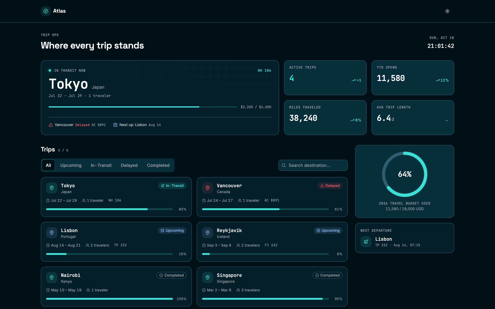
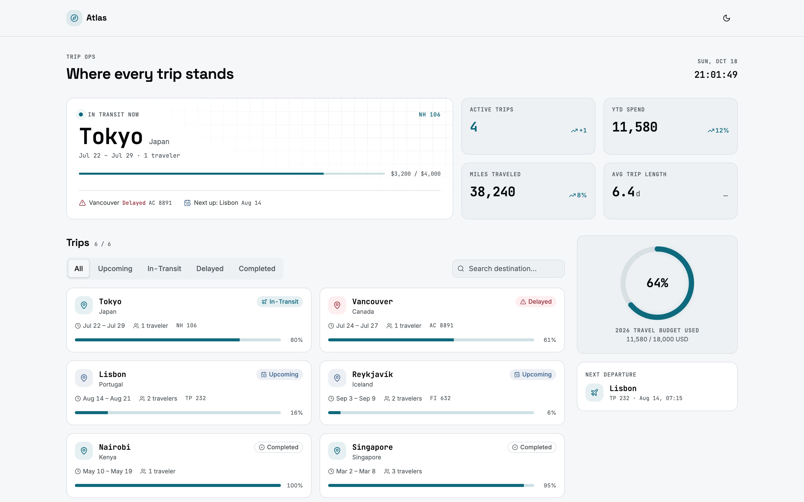

# Atlas — Travel Dashboard

A travel-operations dashboard and the component library it's built from: one repo, one set of tokens, two outputs. Dark and light themes, built with Vite + React 19 + Tailwind v4 + shadcn/ui (new-york) + Storybook 8.

**Live:** [dashboard](https://atlas-travel-dashboard.vercel.app/) · [Storybook](https://atlas-travel-storybook.vercel.app/)

| Dark | Light |
|---|---|
|  |  |

## Key decisions

- **Two token layers, validated.** Semantic colors (`primary`) must point at a primitive (`teal-300`). The generator rejects raw hex, unknown references, a missing light value, or off-scale spacing.
- **The build enforces the tokens.** `npm run build` fails if a generated file is stale or hand-edited, so drift can't reach production.
- **Accessibility lives in the tokens.** Every status pairs color with an icon, and tint strengths were set so badge text clears WCAG AA in both themes.
- **Every panel handles its states.** Loading, error with retry, and empty where it applies. Each panel has its own error boundary, so one failure doesn't take down the page.

## Tokens

- **Edit one file:** `src/tokens.json`. `npm run tokens` generates `primitives.css` and `semantics.css` (for the app and Storybook) and `tokens.ts` (for Storybook's own UI).
- **`dev` and `storybook` regenerate on start.** If a dev server is already running, run `npm run tokens` to pick up changes.
- **Commit the generated files** with your `tokens.json` change, since `build` checks them instead of regenerating.

`product.md` is the brief. `design.md` is the design spec, with the reasoning behind each value.

## Run it

```bash
npm install
npm run dev            # the dashboard — http://localhost:5173
npm run storybook      # the component library docs — http://localhost:6006
```

## Scripts

| Script | What it does |
|---|---|
| `npm run dev` | Vite dev server for the dashboard app |
| `npm run build` | Token check + typecheck + production build → `dist/` |
| `npm run preview` | Preview the production build |
| `npm run storybook` | Storybook dev server |
| `npm run build-storybook` | Production Storybook build → `storybook-static/` |
| `npm run tokens` | Regenerate `primitives.css`, `semantics.css` + `tokens.ts` from `tokens.json` |
| `npm run check:tokens` | Fail if the generated files are stale or were hand-edited |

## Structure

```
src/
├── App.tsx                # renders the assembled dashboard
├── tokens.json             # design tokens — the one file to edit
├── primitives.css          # generated: layer 1 — palette + motion
├── semantics.css           # generated: layer 2 — @theme roles + themed colors
├── tokens.ts               # generated: same tokens as JS, for Storybook
├── index.css               # imports the token CSS + base styles and motion layer
├── components/
│   ├── ui/                 # shadcn primitives (Button, Card, Badge, Input, Tabs, Progress, Skeleton)
│   └── travel/              # domain components (MetricCard, TripCard, BudgetRing, IconContainer, EmptyState, PanelError)
├── dashboard/                # the app layer — types, mock data, hooks, panels
│   └── panels/               # TopBar, OpsBoard, StatRow, TripFeed, GoalPanel, PanelBoundary
└── stories/                  # Storybook stories, one per component (sidebar: Components/UI | Travel | Recipes)
    ├── pages/                # Foundation/Overview, Primitives, Semantics + Components/Overview
    └── docs/                 # shared layout for those pages (PageHeader, Section, Note, LinkCard)
```

Components are presentational (props in, no fetching); all data lives in `src/dashboard/`. Swap `dashboard/hooks.ts` for real API calls later — nothing else needs to change.
